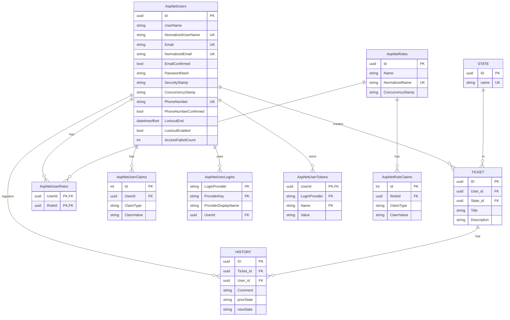

## Prompt1
### Descripción
Prompt de inicio de proyecto, creación de Modelos y Cliente de Base de datos
### Prompt
Quiero que lo siguiente que hagas sea la creación de directorios siguiente el patron de arquitectura de API Rest por capas, además de la configuración del cliente de EF core, implementando los modelos con los cuales va a trabajar la basde de datos, esta debe seguir el Diagrama ER proporcionado. Debes de respetar el esquema, los tipos de datos y los tipos de claves marcadas. de igual forma quiero que generes un archivo donde se declaren los SP (Store Procedures) FN (functions) y TG (Triggers). Finalmente quiero que des la configuración basica Inicial de la conexion entre el ciente EF core con el Context del API. 
Consideraciones:
- Al trabajar con un API Realizada con C# las capaz de Controller y de Routes Son una.
- La ruta Raiz donde se administran los elementos como se controllers, services y repositories, debe ser `./src`, en contraste para la base de datos debe ser `./Infrastructure`, desde el cliente/context, los modelos y la condifuracion de Identity y Secuerity por parte de AspNetCore Identity. 
Estructura de Modelos Esperada:
- Considera la estandarización de tipos de respuestas es decir mediante handlers. formando formatos standar de respuestas.

---
## Prompt2
### Descripción
Prompt de ajuste de migraciones y seeds
### Prompt
Quiero que añadas created at, updated at en todas las tablas, de igual forma quiero que crees los archivos de seed, donde se indiquen los roles de Admin, Operator y technician (NORMALIZA los nombres) a la par que un usuario de prueba de tipo admin con datos extraidos del env para no revelar datos sensibles.  de igual forma Los siguientes estados: Pendiente, En Proceso y Resuelto.